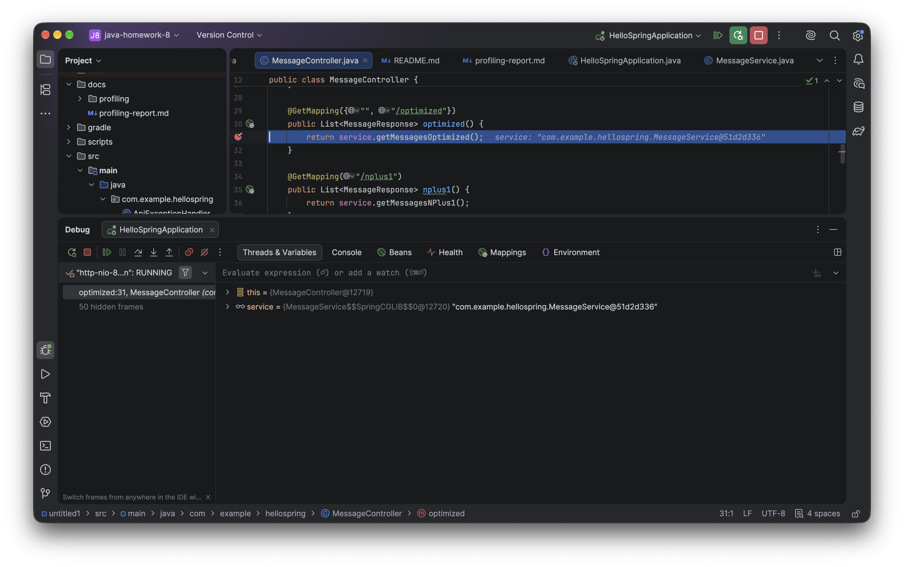
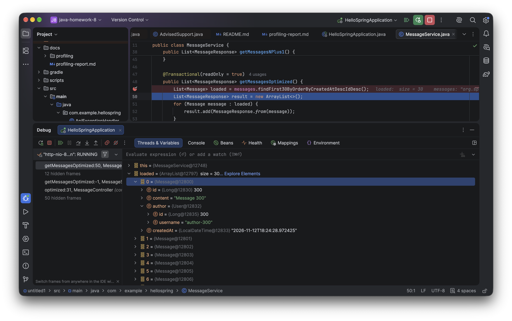
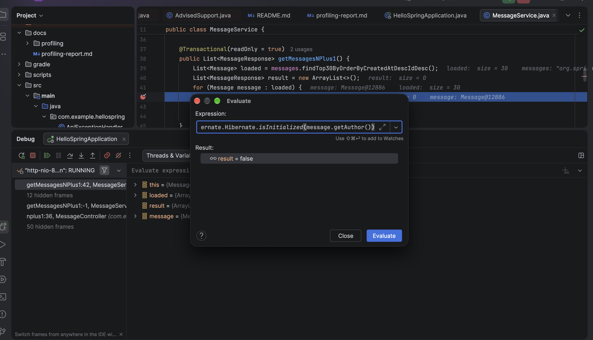
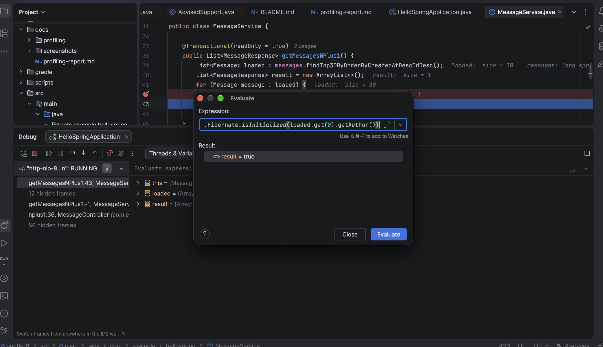
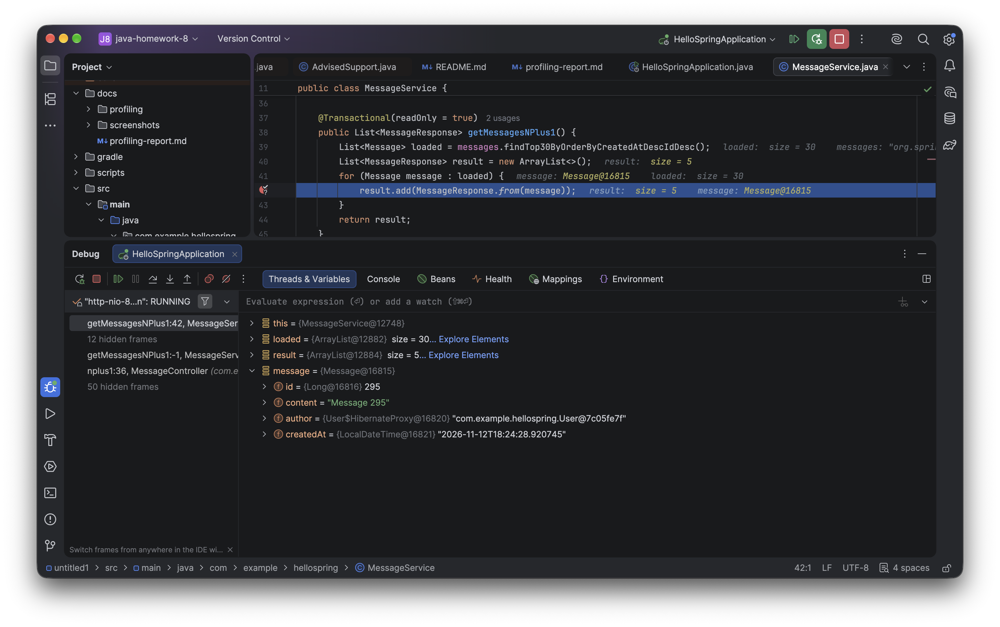
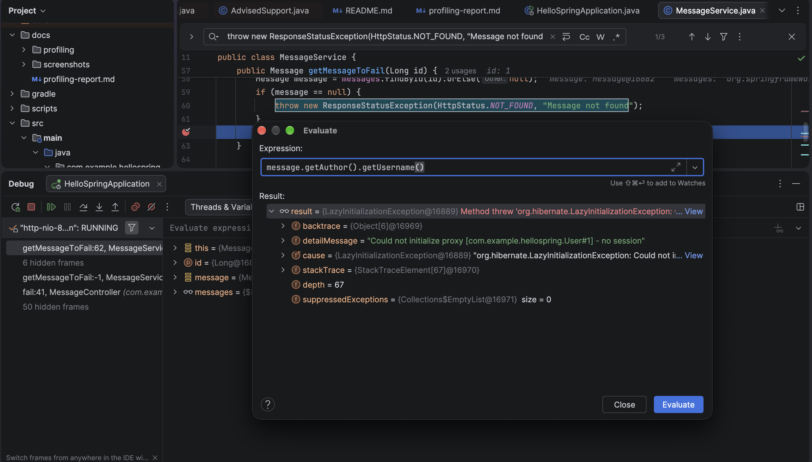
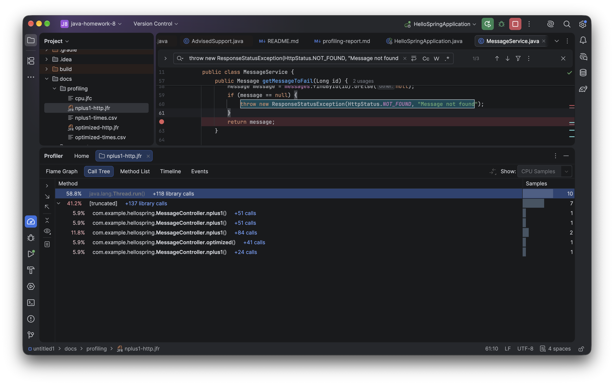
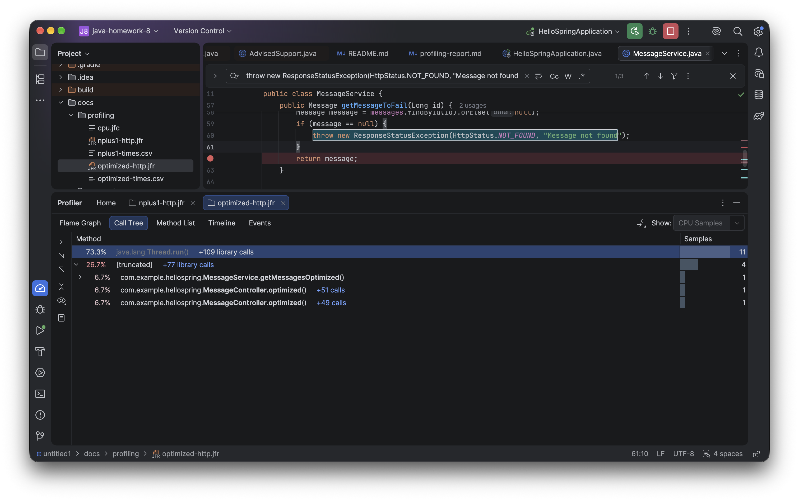

# ДЗ 8. Инструменты разработчика

Java 17, Spring Boot, Gradle, JPA, H2. Порт 8088.

## Запуск

```bash
./gradlew build
./gradlew bootRun
```

В другом терминале:

```bash
./gradlew runTestDataInitializer
```

300 сообщений. База очищается при перезапуске. Версии JPA/Hibernate задаёт BOM Spring Boot.

```bash
curl http://localhost:8088/api/messages/nplus1
curl http://localhost:8088/api/messages/optimized
curl -i http://localhost:8088/api/messages/fail/1
```

## Отладка

F7: контроллер → сервис.



F8: получены сообщения с авторами.



N+1: автор ещё не загружен — false.



После обращения к автору — true.



Условие: `message.getId() == 295L`.



Evaluate: `message.getAuthor().getUsername()`. Сессия закрыта — LazyInitializationException.



## Профилирование

JFR, 12.11.2026. Без Debug, после прогрева, по 3000 запросов. Период — 1 мс.

```bash
jcmd -l
bash scripts/profile.sh 12345
```

12345 заменить PID приложения. Запускать один скрипт за раз.

Call Tree для N+1:



Call Tree для optimized:



| Показатель | N+1 | Optimized |
| --- | ---: | ---: |
| Запросов | 3000 | 3000 |
| Среднее время ответа, мс | 1,387 | 1,162 |
| Средняя загрузка CPU JVM | 1,277% | 1,017% |
| Java-сэмплов | 17 | 15 |

CPU: среднее JFR `jvmUser + jvmSystem`, нормированное на всю машину. Время ответа — из curl.

В N+1 видна lazy-загрузка автора, в обоих профилях — Tomcat и Spring MVC. Сэмплов мало; запись N+1 частично пересеклась с другой нагрузкой. Главный потребитель CPU достоверно не определён.

Optimized показал меньшую задержку и загрузку CPU. Тест подтверждает 31 SQL-запрос против одного; это не равно ускорению CPU в 31 раз.

[JFR N+1](docs/profiling/nplus1-http.jfr) · [JFR optimized](docs/profiling/optimized-http.jfr)

[Время ответов N+1](docs/profiling/nplus1-times.csv) · [Время ответов optimized](docs/profiling/optimized-times.csv)
